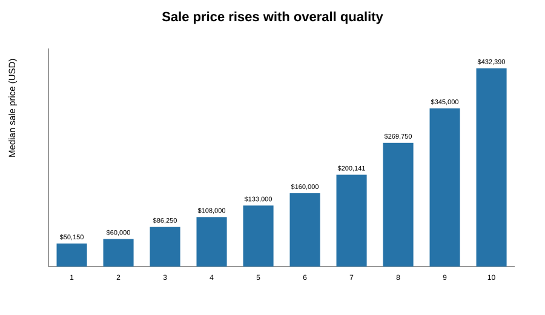
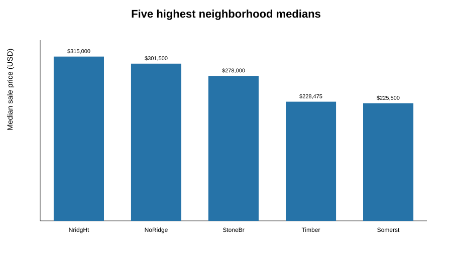
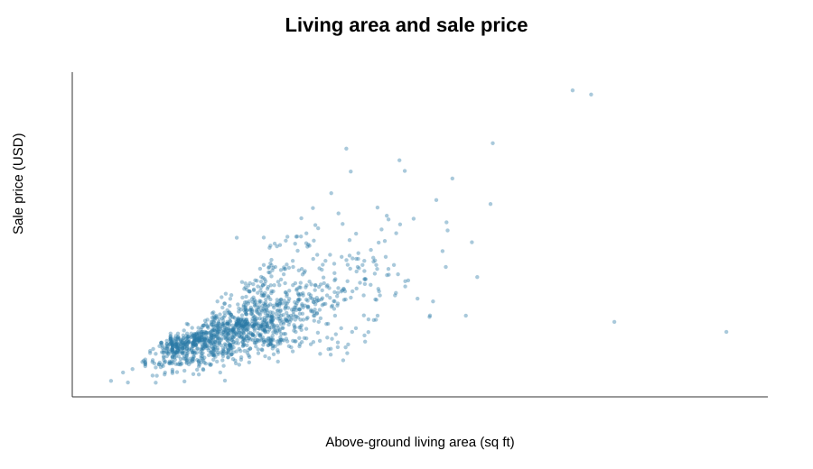

# What is associated with higher home sale prices in Ames, Iowa?

## Problem
For this educational analysis, I ask: **How strongly are observable home size and overall quality associated with sale price, and can the available features predict prices on unseen rows?** This is an association and prediction exercise, not a causal estimate or a current-market valuation tool.

## Data source and license
The files come from Kaggle's *House Prices: Advanced Regression Techniques* competition, using the Ames, Iowa residential sales compiled for education by Dean De Cock. Kaggle describes the training file as 1,460 sales with 79 explanatory variables and a SalePrice outcome. The competition data page requires users to accept its competition rules; it does not state a standard open-data license in the downloaded package. **Treat the CSVs as Kaggle competition data under Kaggle's terms, not as MIT/CC licensed material.** Do not redistribute the source files publicly without confirming Kaggle's current terms. Dataset page: https://www.kaggle.com/competitions/house-prices-advanced-regression-techniques/data . Original article: De Cock (2011), *Ames, Iowa: Alternative to the Boston Housing Data as an End of Semester Regression Project*, Journal of Statistics Education, 19(3), https://doi.org/10.1080/10691898.2011.11889627 .

The public repository is https://github.com/roee0910/cs82a-portfolio/tree/main/final_project and contains this report, notebook, charts, model comparison, and prompt log; raw Kaggle files are excluded from version control to respect the competition terms. Obtain the files from Kaggle and put `train.csv` and `test.csv` in `data/` before running.

## Cleaning log
- Loaded 1,460 training rows and 81 columns; `Id` is a row identifier and excluded from analysis/modeling; `SalePrice` is the target.
- The training table contains 7,829 missing cells. Many blanks encode structural absence (for example, no alley/garage/pool) in this dataset; categorical blanks are represented as `Missing` in modeling, preserving that signal instead of treating them as zero.
- Numeric missing values are filled with medians learned only from the training fold. Categorical predictors are one-hot encoded; validation-only categories safely map to all-zero feature columns.
- `SalePrice` is right-skewed (median $163,000, mean $180,921); the model target is natural-log `SalePrice`. No rows were removed and no target-based cleaning was performed.
- Split: seeded random 80/20 holdout (1,168 train / 292 test rows), then 5-fold shuffled cross-validation inside the training split. All imputers, category levels, and scaling statistics are learned within each fold through a scikit-learn Pipeline. Candidate hyperparameters were fixed in advance; CV selects among the mean baseline, Ridge, Lasso, and Random Forest.

## Findings
1. **Quality has a strong monotonic association with price.** Median sale price increases from $50,150 for OverallQual 1 to $432,390 for OverallQual 10 (about 8.6×).  The scale is an ordinal rating, so gaps are not assumed equal.
2. **Location matters in this sample.** The five neighborhoods with the highest observed median prices are NridgHt ($315,000), NoRidge ($301,500), StoneBr ($278,000), Timber ($228,475), Somerst ($225,500).  These are in-sample descriptive medians and small groups can be unstable.
3. **Living area and price move together, with substantial spread.** Pearson correlation between GrLivArea and SalePrice is 0.71; the scatterplot shows that size alone does not determine price. 
4. **Train-only CV and held-out test comparison (bonus).** The target is natural-log sale price. An 80/20 split (`random_state=42`) is made before preprocessing. Five-fold shuffled CV runs only on the 80% training split. Imputation, scaling, and one-hot encoding live inside each model Pipeline, so every fold fits preprocessing only on its own training portion. CV mean log-RMSE / mean R²: mean baseline **0.3901 / −0.0013**; Ridge **0.1426 / 0.8638**; Lasso **0.1409 / 0.8656**; Random Forest **0.1441 / 0.8633**. Lasso was selected by train-only CV. On the held-out 20% test set, log-RMSE / R² were: mean baseline **0.4332 / −0.0058**; Ridge **0.1365 / 0.9002**; Lasso **0.1287 / 0.9112**; Random Forest **0.1467 / 0.8846**. Results are in `model_comparison.csv`. The selected Lasso test residuals (observed minus predicted log price) have mean **−0.0051**, median **0.0052**, 5th–95th percentile **[−0.1969, 0.1679]**, and prediction-residual correlation **0.115**; see `figures/lasso_test_residuals.svg`. No test score was used to choose the winning model.

## Limitations and ethics
This is a historical sample of Ames sales, mostly 2006–2010, and is not representative of current prices or other places. The random holdout measures interpolation among similar historical records, not future forecasting. Neighborhood medians are descriptive and confounded by home quality, size, and other attributes. Sale price reflects transaction circumstances; no causal claims are made. Kaggle's `Id` is not a person identifier and is excluded. The provided fields describe properties; no direct personal identifiers are used. Missing categories can carry substantive information. Model error is large enough that individual predictions should not be used for financial decisions. The notebook used AI assistance, disclosed in `PROMPT_LOG.md`.

## How to run
1. Install Python 3.10+ and dependencies: `python -m pip install -r requirements.txt`.
2. Download competition data from Kaggle and place `train.csv` in `data/` (and `test.csv` only if extending to competition predictions).
3. Open `ames_housing_analysis.ipynb` in Jupyter and run all cells from top to bottom. The notebook builds the three descriptive charts and selected-model residual plot, then repeats the train-only cross-validation and test comparison. Random seed is 42. The notebook compares a mean baseline, Ridge, Lasso and Random Forest with five-fold CV on train only, then reports held-out test log-RMSE and R² plus selected-model residual diagnostics.

## Walkthrough
A 3–5 minute spoken walkthrough outline and caption-ready script are in `WALKTHROUGH.md`.
